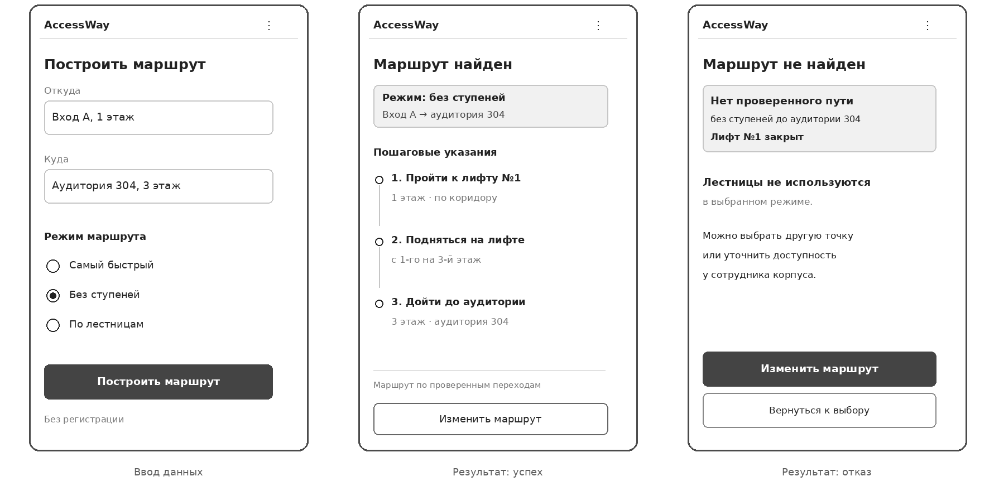
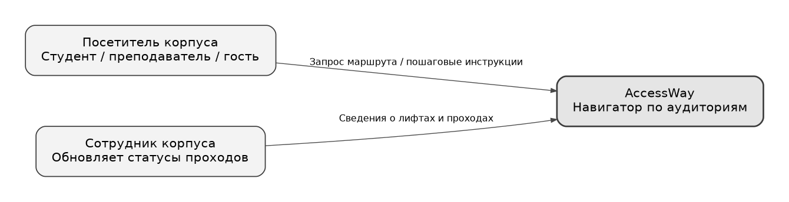
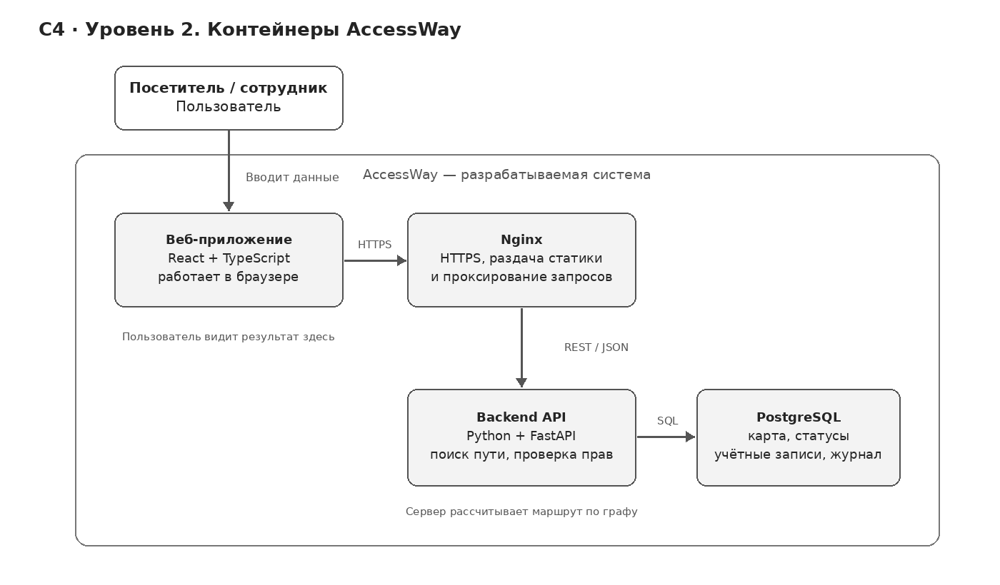

# AccessWay — навигатор по университетским корпусам

**AccessWay** — IT-сервис для навигации внутри многоэтажных зданий университета. Он помогает студентам, преподавателям и посетителям находить нужные аудитории, учитывая коридоры, лестницы, лифты и переходы между этажами. Пользователь может выбрать самый быстрый маршрут, путь по лестницам или маршрут без ступеней.

Бизнес-модель — **B2B2C**: университет оплачивает подключение и сопровождение навигатора, а студенты и посетители используют его бесплатно. На первом этапе проект рассчитан **на один университетский корпус**, для которого заранее подготовлена и проверена схема помещений.

---

## Домашнее задание №1. Elevator Pitch и Lean Canvas

### 1. Выбор идеи и бизнес-модели

В больших университетских корпусах бывает трудно добраться из одной аудитории в другую. Помещения находятся на разных этажах, переходы между частями здания могут быть запутанными, а обычные таблички не всегда показывают, где удобнее подняться или спуститься. Особенно сложно посетителям, которые впервые оказались в корпусе, и людям, которым нельзя пользоваться лестницами.

**AccessWay решает эту проблему с помощью цифрового навигатора.** Человек выбирает начальную точку и нужную аудиторию, после чего получает маршрут с понятными инструкциями: пройти по коридору, повернуть, подняться на определённый этаж по лестнице или воспользоваться лифтом. Для маршрута по лестницам можно показать направление подъёма/спуска и примерное число ступеней.

Основные пользователи — студенты, абитуриенты, преподаватели, гости университета и люди с ограниченной мобильностью. Покупатель сервиса — университет или организация, отвечающая за эксплуатацию корпуса. Такой подход позволяет не брать деньги с посетителей, которым навигация нужна непосредственно в здании.

На старте мы не пытаемся составить карты всех университетов. Сначала обследуем один корпус и проверим, способны ли пользователи правильно проходить маршруты по его схеме.

---

### 2. Elevator Pitch

1. Проблема

Представьте, что вам нужно попасть в аудиторию на другом этаже незнакомого университетского корпуса, но вы не знаете, по какой лестнице подняться, где находится лифт и как добраться до нужного помещения. Из-за сложной планировки студенты и посетители теряют время на поиски, а для людей с ограниченной мобильностью неправильный маршрут может оказаться непреодолимым препятствием.

2. Решение

AccessWay — веб-навигатор, который строит маршруты внутри университетских корпусов с учётом расположения аудиторий, этажей, лестниц, лифтов и переходов между ними. Пользователь указывает пункт назначения и получает пошаговые инструкции, как до него добраться.

3. Киллер-фича

Главная особенность AccessWay — возможность выбрать один из трёх режимов: самый быстрый маршрут, маршрут по лестницам или путь без ступеней. Система учитывает доступность переходов и не предлагает лестницы пользователям, которым они не подходят. Если доступного маршрута нет, приложение сообщает об этом.

4. Профит 

Студенты, преподаватели и посетители смогут быстрее ориентироваться в незнакомых корпусах и выбирать маршруты с учётом своих возможностей. Университет получит инструмент для улучшения навигации, повышения доступности образовательной среды и потенциального снижения нагрузки на сотрудников, к которым обращаются за помощью.

5. CTA 

Предлагаем запустить пилотную версию AccessWay в одном университетском корпусе, протестировать построение маршрутов и оценить удобство навигации на практике. Готовы рассмотреть возможность внедрения такого сервиса в вашем университете?

---

### 3. Lean Canvas

Ниже представлена Lean Canvas, заполненная по девяти блокам.


---

## Домашнее задание №2. HADI, юнит-экономика и Pivot

### 1. Ключевой риск и HADI-гипотеза

Самый критичный риск из Lean Canvas — **университетам может быть полезен навигатор, но они не захотят выделять деньги на его подключение**. Если организации не готовы платить, даже технически работающий сервис не сможет существовать на выбранной модели B2B2C.

Для проверки этого риска используем фреймворк HADI:

1. **H — Hypothesis (гипотеза).** Мы считаем, что хотя бы **2 из 20** представителей университетов, способных участвовать в решении о закупке, после демонстрации AccessWay письменно подтвердят готовность обсуждать платный пилот по цене **12 000 ₽ в месяц за корпус**.
2. **A — Action (действия).** Найдём 20 представителей университетов, проведём проблемные интервью, покажем прототип и предложим конкретные условия пилота. Уточним, кто отвечает за карты зданий и доступность, может ли учреждение предоставить план корпуса и выделить бюджет.
3. **D — Data (данные).** Зафиксируем количество ответов, проведённых встреч и демонстраций, число письменных подтверждений интереса именно к платному пилоту и основные причины отказов.
4. **I — Insights (выводы).** Если получим не менее **2 подтверждений из 20**, гипотеза получит предварительную поддержку. Если получим **0–1**, пересмотрим канал продаж, цену или целевой сегмент. Даже положительный ответ не равен оплаченной подписке, поэтому следующий этап — проверить реальную оплату пилота.

Дополнительно перед запуском необходимо протестировать точность маршрутов и понятность инструкций с посетителями, в том числе с людьми, которым нужен безбарьерный путь.

---

### 2. Юнит-экономика

В качестве **юнита** возьмём **один платящий корпус**, который университет подключил к сервису на подписку. Студенты и посетители не являются платящими клиентами, поэтому считать CAC на каждого студента было бы неправильно.

#### CAC — стоимость привлечения клиента

Предположим, что первоначально мы привлекаем университеты через интернет-рекламу и заявки на демонстрацию продукта. Для учебного расчёта примем такую воронку:

- Стоимость одного рекламного клика — **250 ₽**.
- Количество кликов — **400**; расходы на рекламу: **250 × 400 = 100 000 ₽**.
- Конверсия клика в заявку — **8%**, значит получим **32 заявки**.
- Из заявок в демонстрацию переходят **25%**, то есть **8 демонстраций**.
- Из демонстраций в платное подключение переходят **25%**, то есть **2 корпуса**.

**CAC = 100 000 / 2 = 50 000 ₽** на один подключённый корпус.

В этом упрощённом рекламном сценарии не учтены отдельные зарплаты менеджеров, поездки и подготовка демонстраций. Если эти затраты есть, фактический CAC будет выше. Все конверсии пока предполагаемые.

#### LTV — прибыль от клиента за время сотрудничества

Предполагаем следующие значения:

- Подписка за один корпус — **12 000 ₽/мес.**
- Хостинг и сопровождение — **2 000 ₽/мес.** на корпус.
- Первоначальное обследование и подготовка карты — **12 000 ₽** однократно.
- Средний срок оплачиваемой подписки — **12 месяцев**.

Маржинальный доход за один месяц: **12 000 − 2 000 = 10 000 ₽**.

**LTV = (12 000 − 2 000) × 12 − 12 000 = 108 000 ₽**.

Это маржинальный LTV до общих расходов компании, а не окончательная чистая прибыль: разработка, общая администрация и налоги отдельно не распределены на одного клиента.

#### Сходимость экономики

**LTV / CAC = 108 000 / 50 000 = 2,16**.

После вычета привлечения остаётся **108 000 − 50 000 = 58 000 ₽** маржинального вклада за весь условный период обслуживания до постоянных расходов. Примерная окупаемость затрат на привлечение и создание карты: **(50 000 + 12 000) / 10 000 = 6,2 месяца**.

---

### 3. Pivot — запасной план

Вместо массовой рекламы будем напрямую связываться с университетами, демонстрировать работу навигатора и предлагать пилот в одном корпусе. Сама идея AccessWay и модель подписки не меняются.

Для проверки нового плана примем следующий сценарий:

- **80** целевых обращений к университетам.
- **20** демонстраций продукта (25% от обращений).
- **3** платных подключения (15% от демонстраций).
- Полные прямые расходы на поиск клиентов, работу менеджера, материалы и встречи — **60 000 ₽**.

**Новый CAC = 60 000 / 3 = 20 000 ₽**.

**LTV / CAC = 108 000 / 20 000 = 5,4**.

В этом сценарии экономика выглядит лучше, а примерная окупаемость затрат на привлечение и карту составляет **(20 000 + 12 000) / 10 000 = 3,2 месяца**. Pivot будем считать успешным только после реальных оплаченных пилотов и измерения фактического CAC.

---

## Домашнее задание №3. User Stories, MVP, MLP, ФТ и НФТ

### 1. Роли пользователей и User Stories

В системе выделим четыре роли:

- **Посетитель корпуса** — студент, преподаватель, абитуриент или гость, который ищет аудиторию.
- **Посетитель, которому нужен маршрут без ступеней** — например, человек на коляске или с ограниченной мобильностью.
- **Сотрудник корпуса** — проверяет информацию о лестницах, лифтах и проходах, обновляет их статусы.
- **Представитель университета** — принимает решение о подключении сервиса и оценивает его полезность.

User Stories описывают возможности системы с точки зрения пользователей:

1. **US-01.** Как посетитель, которому нельзя пользоваться лестницами, я хочу включить режим «Без ступеней», чтобы получить подходящий маршрут.
2. **US-02.** Как посетитель корпуса, я хочу выбрать начальную точку и аудиторию назначения, чтобы построить маршрут между ними.
3. **US-03.** Как посетитель на коляске, я хочу получать маршрут только через проверенные доступные проходы и лифты, чтобы не встретить непреодолимое препятствие.
4. **US-04.** Как посетитель, я хочу видеть пошаговые инструкции с номерами этажей, чтобы понимать, куда поворачивать, подниматься и спускаться.
5. **US-05.** Как посетитель, я хочу получать сообщение, если доступный маршрут отсутствует, чтобы не пытаться пройти по неподходящему пути.
6. **US-06.** Как посетитель, я хочу, чтобы неисправный лифт исключался из маршрута, чтобы не подходить к закрытому переходу.
7. **US-07.** Как сотрудник корпуса, я хочу менять статус лифта и прохода, чтобы система учитывала актуальные ограничения.
8. **US-08.** Как сотрудник корпуса, я хочу исправлять тип и параметры переходов, чтобы схема соответствовала обследованному зданию.
9. **US-09.** Как посетитель, я хочу строить маршрут без регистрации, чтобы сразу пользоваться навигатором.
10. **US-10.** Как посетитель, я хочу видеть обозначения лестниц, лифтов и коридоров на схеме, чтобы лучше ориентироваться.
11. **US-11.** Как посетитель, я хочу выбирать альтернативный вход, чтобы находить путь, если основной вход закрыт.
12. **US-12.** Как посетитель, я хочу видеть приблизительное время в пути, чтобы планировать прибытие на занятие.
13. **US-13.** Как посетитель с ограниченной мобильностью, я хочу учитывать минимальную ширину прохода, чтобы маршрут подходил для моего средства передвижения.
14. **US-14.** Как посетитель со слабым зрением, я хочу слушать пошаговые инструкции, чтобы меньше зависеть от текста на экране.
15. **US-15.** Как студент, я хочу сохранять избранные аудитории, чтобы быстро строить повторяющиеся маршруты.
16. **US-16.** Как посетитель, я хочу сообщать о закрытом проходе, чтобы сотрудник смог проверить и обновить карту.
17. **US-17.** Как студент, который может пользоваться лестницами, я хочу выбирать самый быстрый маршрут или путь по лестницам, чтобы не ждать лифт без необходимости.
18. **US-18.** Как посетитель, я хочу видеть примерное ожидание лифта и источник этой оценки, чтобы осознанно выбирать между лестницей и лифтом.

---

### 2. Приоритизация функционала

Используем **MoSCoW**, так как в первую очередь нужно выделить функции, без которых маршрут либо невозможно построить, либо нельзя считать пригодным для использования.

#### Must have — обязательно в MVP

**US-01–US-09, US-17.** Выбор режима, старта и цели; построение маршрута по графу здания; лестницы и лифты; пошаговые инструкции; обработка отсутствующего пути; учёт блокировок и их обновление сотрудником; возможность пользоваться без регистрации. Эти функции составляют основу продукта.

#### Should have — желательно после запуска

**US-10, US-11, US-13, US-16.** Условные обозначения на схеме, альтернативные входы, фильтрация по ширине прохода и возможность сообщить о препятствии. Они повышают точность и удобство, но не должны задерживать проверку базового сценария.

#### Could have — дополнительные удобства

**US-12, US-14, US-15, US-18.** Примерное время в пути, голосовые инструкции, избранные места и расчёт ожидания лифта. Последняя функция может потребовать дополнительных данных от системы лифта.

#### Won't have — не входит в первые версии

Автоматическое определение местоположения внутри здания по маякам, интеграция с контроллером лифта в реальном времени, навигация по всем корпусам города, функции эвакуации. Эти возможности увеличивают сложность и не нужны для проверки основной идеи.

---

### 3. MVP и MLP

#### MVP — минимально жизнеспособный продукт

**Ценность для пользователя:** найти аудиторию в одном корпусе и получить корректные инструкции через лестницу или лифт, с возможностью выбрать путь без ступеней.

**Необходимый минимум возможностей:**

- Заранее проверенная карта одного корпуса с этажами, аудиториями, коридорами, лестницами и лифтами.
- Выбор начальной и конечной точек, три режима маршрута.
- Алгоритм поиска кратчайшего подходящего пути и инструкции «подняться / спуститься».
- Исключение заблокированных и непроверенных переходов; предупреждение, если нужного маршрута нет.
- Простая защищённая возможность сотрудника изменить статус перехода.

**Направление развития:** после тестирования улучшить читаемость маршрутов, добавить альтернативные входы, параметры доступности, отметки о препятствиях и прогнозирование времени.

**Итеративный процесс:** схема одного корпуса → интерактивный прототип → проверка правильности маршрутов → тесты с посетителями → исправление ошибок → пилот на реальной карте. Мы будем измерять успешность прохождения маршрута и время поиска аудитории.

#### MLP — дополнительные функции для удобства

- Голосовые подсказки и более понятная визуальная схема переходов.
- Альтернативные входы и индивидуальные настройки доступности.
- Избранные аудитории и сообщения об изменении маршрута.
- Оценка времени прибытия лифта, если доступны достоверные данные или явно обозначенная модель ожидания.

MLP развивается поверх проверенного MVP, а не заменяет его.

---

### 4. Функциональные и нефункциональные требования

Для детализации возьмём две основные истории из MVP: **US-03 — построение доступного маршрута** и **US-07 — обновление статуса лифта или прохода**.

#### История US-03. Построение доступного маршрута

**User Story:** Как посетитель на коляске, я хочу получать маршрут только через проверенные доступные переходы, чтобы добраться до нужной аудитории без лестниц и непроходимых участков.

**ФТ (функциональные требования):**

1. Пользователь может выбрать старт и аудиторию назначения из опубликованной схемы корпуса.
2. При выборе режима «Без ступеней» система полностью исключает лестницы из рассматриваемых переходов.
3. Система не строит путь через закрытые, неисправные и непроверенные переходы.
4. Система находит подходящий путь с минимальным расчётным временем по доступному графу.
5. Результат содержит последовательность действий, номера этажей и тип каждого перехода.
6. Если подходящего пути нет, система сообщает об этом и **не подменяет его маршрутом через лестницу**.
7. При совпадении начальной и конечной точек система сообщает, что пользователь уже находится у цели.

**НФТ (нефункциональные требования):**

1. Построение маршрута на тестовой карте до 500 узлов и 2 000 переходов должно занимать **не больше 2 секунд в 95% запросов** на целевой среде (проектный критерий).
2. Основные действия доступны с клавиатуры; элементы интерфейса имеют понятные текстовые обозначения для вспомогательных технологий.
3. Интерфейс корректно работает на экранах смартфонов и ноутбуков, без горизонтальной прокрутки основных элементов управления при ширине от 360 px.
4. Каждый переход на опубликованной карте хранит статус доступности и дату последней проверки.
5. Если достоверность перехода не подтверждена, система не должна представлять его как гарантированно доступный.

**Проверка:** если единственный лифт между первым и вторым этажами отмечен неисправным, маршрут «Без ступеней» не должен содержать лестницу — система сообщает об отсутствии подтверждённого пути. При обычном режиме разрешён маршрут по лестнице, если она доступна.

#### История US-07. Обновление статуса лифта или прохода

**User Story:** Как уполномоченный сотрудник корпуса, я хочу отмечать неисправные лифты и закрытые проходы, чтобы посетители получали маршруты с учётом текущих ограничений.

**ФТ (функциональные требования):**

1. Авторизованный сотрудник выбирает переход из списка своего корпуса.
2. Сотрудник может установить статус «доступен», «закрыт» или «не проверен».
3. Перед сохранением система запрашивает подтверждение изменения.
4. Система записывает автора, дату, предыдущее значение и причину изменения.
5. После успешного сохранения новые маршруты учитывают обновлённый статус.
6. При ошибке сохранения сотрудник видит сообщение, а прежний статус остаётся действующим.
7. Возвращать статус «доступен» после поломки можно только после подтверждения проверки прохода или лифта.

**НФТ (нефункциональные требования):**

1. Изменять статусы может только сотрудник с соответствующими правами; обычный посетитель не может отправить такое изменение.
2. Обновление перехода и запись в журнал выполняются как единая операция без частичного сохранения.
3. После подтверждённого обновления новые запросы маршрута используют изменённый статус **не позднее 5 секунд** (проектный критерий).
4. Журнал изменений должен сохранять переход, старый и новый статус, время, автора и причину.
5. При сбое связи система не сообщает, что изменение успешно применено, если сервер его не подтвердил.

**Проверка:** сотрудник закрывает лифт → появляется запись в журнале → новый маршрут перестаёт использовать лифт. Если пользователь без прав пытается изменить статус, система отклоняет запрос.

---

**Важно:** навигатор нельзя использовать для эвакуации. Для реального запуска необходимы обследование здания, подтверждение доступности маршрутов и порядок регулярного обновления карты.


---

## Домашнее задание №4. Проектирование

### 1. DDD — доменные зоны и глоссарий

Для AccessWay выделены четыре доменные зоны. Такое разделение позволяет отдельно управлять картой корпуса, построением маршрутов, доступностью переходов и правами сотрудников. В MVP все зоны реализуются как модули одного приложения, без разделения на микросервисы.

**1. Карта корпуса (Building Map)**

Отвечает за хранение схемы здания, расположение этажей, аудиторий, входов, коридоров, лестниц и лифтов. Перед публикацией схема проверяется сотрудниками университета.

Глоссарий:
- **Building (Корпус)** — здание, для которого создана карта.
- **Floor (Этаж)** — уровень корпуса с помещениями и переходами.
- **Waypoint (Точка)** — место на карте: вход, поворот коридора, аудитория или площадка лифта.
- **Edge (Переход)** — соединение двух точек графа: коридор, лестница или лифт.
- **Map Revision (Версия карты)** — версия опубликованной схемы здания.

**2. Маршрутизация (Routing)**

Отвечает за поиск пути между выбранными точками. Система анализирует граф здания, исключает запрещённые переходы и формирует последовательность инструкций для пользователя.

Глоссарий:
- **Route Request (Запрос маршрута)** — начальная точка, конечная точка и выбранный режим.
- **Route Mode (Режим маршрута)** — самый быстрый, по лестницам или без ступеней.
- **Route (Маршрут)** — последовательность разрешённых переходов от начала до цели.
- **Route Step (Шаг маршрута)** — инструкция с направлением движения и номером этажа.
- **No Route (Отсутствие маршрута)** — результат, означающий, что подходящий путь не найден.

**3. Доступность переходов (Availability)**

Отвечает за текущее состояние лифтов, лестниц и коридоров. Если лифт неисправен или проход закрыт, система исключает соответствующие переходы из расчёта маршрута. В MVP сведения об изменениях вносит сотрудник университета.

Глоссарий:
- **Facility (Объект перехода)** — лифт, лестница или проход, состояние которого можно изменять.
- **Availability Status (Статус доступности)** — доступен, закрыт или не проверен.
- **Inspection (Проверка)** — подтверждение состояния объекта сотрудником.
- **Status Change (Изменение статуса)** — запись об изменении доступности объекта.
- **Availability Revision (Ревизия состояния)** — номер версии сведений о доступности.

**4. Администрирование (Administration)**

Обеспечивает авторизацию сотрудников и управление служебными функциями. Обычные посетители могут пользоваться навигатором без регистрации, но не могут изменять сведения о здании.

Глоссарий:
- **Visitor (Посетитель)** — пользователь, который ищет маршрут.
- **Staff User (Сотрудник)** — авторизованный пользователь с правами редактирования.
- **Role (Роль)** — набор разрешённых действий.
- **Audit Log (Журнал изменений)** — история обновлений с указанием времени и автора.
- **Revision Conflict (Конфликт версий)** — попытка сохранить устаревшие сведения об объекте.

Доменные зоны взаимодействуют следующим образом: карта предоставляет граф здания, зона доступности — актуальные ограничения, маршрутизация вычисляет подходящий путь, а администрирование определяет, кто имеет право обновлять данные. При поломке лифта его не требуется удалять с карты: достаточно изменить статус на «Закрыт».

---

### 2. BDD — критический путь MVP

В качестве критического пути выбран сценарий построения маршрута без ступеней между этажами.

Пользователь находится у входа на первом этаже и хочет попасть в аудиторию 304 на третьем этаже. В условном корпусе имеются лестница и один лифт. Другого подтверждённого безбарьерного перехода между этими этажами нет.

**Сценарий №1. Успешное построение маршрута**

**Дано:**
- Пользователь открыл AccessWay.
- В качестве начальной точки выбран «Вход А, 1 этаж».
- Пункт назначения — «Аудитория 304, 3 этаж».
- Лифт №1 исправен, а коридоры до него и после него доступны.

**Когда:**
- Пользователь выбирает режим «Без ступеней».
- Нажимает кнопку «Построить маршрут».

**Тогда:**
- Система находит подходящий маршрут через лифт.
- Показывает инструкции: пройти к лифту №1, подняться на третий этаж и дойти до аудитории 304.
- В маршруте отсутствуют лестницы.
- Пользователь видит последовательность действий и этажи, на которых их необходимо выполнить.

**Сценарий №2. Маршрут построить невозможно**

**Дано:**
- Начальная и конечная точки остаются прежними.
- Пользователь выбрал режим «Без ступеней».
- Лифт №1 имеет статус «Закрыт».
- Других проверенных безбарьерных переходов на третий этаж нет.

**Когда:**
- Пользователь нажимает кнопку «Построить маршрут».

**Тогда:**
- Система проверяет доступные переходы.
- Не предлагает маршрут по лестнице.
- Отображает сообщение «Маршрут без ступеней не найден».
- Указывает причину: «Лифт №1 закрыт».
- Предлагает изменить параметры поиска или уточнить доступность у сотрудника корпуса.

**Критерий приёмки:** если выбран режим «Без ступеней», найденный маршрут не должен содержать лестниц. Если все подходящие переходы недоступны, система сообщает об отсутствии маршрута, а не предлагает неподходящий вариант.

---

### 3. Wireframes — ключевые экраны



Для критического пути разработаны три упрощённых макета.

**Экран 1. Построение маршрута**

Пользователь выбирает начальную точку, нужную аудиторию и режим передвижения. Доступны варианты «Самый быстрый», «Без ступеней» и «По лестницам». После нажатия кнопки «Построить маршрут» приложение отправляет запрос на сервер.

**Экран 2. Маршрут найден**

Система показывает маршрут с последовательностью действий. Для каждого перехода указываются направление движения и этаж. В представленном сценарии пользователь проходит к лифту, поднимается на третий этаж и следует до аудитории.

**Экран 3. Маршрут не найден**

Если подходящих переходов нет, приложение отображает причину отказа. Пользователь может изменить параметры поиска или вернуться к выбору точек.

Макеты отражают оба сценария BDD. Точное определение положения пользователя внутри здания и получение текущего этажа кабины лифта не входят в MVP.

---

### 4. API-First — проектирование JSON-контрактов

Для AccessWay выбраны две основные API-ручки: построение маршрута и обновление состояния лифта. Контракты определяют структуру данных, которыми обмениваются интерфейс и сервер.

**API №1. Построение маршрута**

`POST /api/v1/routes`

**Тело запроса (Request Body):**

```json
{
  "building_id": "b-01",
  "origin_id": "entrance-a-f1",
  "destination_id": "room-304-f3",
  "mode": "step_free"
}
```

**Успешный ответ (Response Body) — 200 OK:**

```json
{
  "status": "found",
  "mode": "step_free",
  "map_revision": 4,
  "availability_revision": 12,
  "steps": [
    {
      "order": 1,
      "type": "corridor",
      "from_floor": 1,
      "to_floor": 1,
      "instruction": "Идите к лифту №1"
    },
    {
      "order": 2,
      "type": "elevator",
      "facility_id": "lift-1",
      "from_floor": 1,
      "to_floor": 3,
      "instruction": "Поднимитесь на третий этаж"
    },
    {
      "order": 3,
      "type": "corridor",
      "from_floor": 3,
      "to_floor": 3,
      "instruction": "Идите до аудитории 304"
    }
  ]
}
```

**Ответ, если маршрут отсутствует — 200 OK:**

```json
{
  "status": "no_route",
  "mode": "step_free",
  "map_revision": 4,
  "availability_revision": 13,
  "reason_code": "NO_VERIFIED_STEP_FREE_PATH",
  "message": "Маршрут без ступеней не найден",
  "blocking_facilities": [
    {
      "id": "lift-1",
      "status": "closed"
    }
  ],
  "steps": []
}
```

Результат `no_route` не является серверной ошибкой: запрос обработан правильно, но подходящий путь отсутствует.

Дополнительные ошибки:
- `400 Bad Request` — некорректные параметры запроса.
- `404 Not Found` — выбранная аудитория отсутствует в опубликованной карте.

**API №2. Изменение статуса лифта**

`PATCH /api/v1/buildings/b-01/facilities/lift-1/status`

Запрос доступен только авторизованному сотруднику.

**Тело запроса (Request Body):**

```json
{
  "status": "closed",
  "reason": "Лифт временно не работает",
  "expected_revision": 12
}
```

**Успешный ответ (Response Body) — 200 OK:**

```json
{
  "facility_id": "lift-1",
  "status": "closed",
  "availability_revision": 13,
  "updated_at": "2026-11-09T14:30:00Z",
  "message": "Статус обновлён"
}
```

**Ответ при конфликте версий — 409 Conflict:**

```json
{
  "error": {
    "code": "REVISION_CONFLICT",
    "message": "Статус изменился. Обновите данные."
  }
}
```

Если сотрудник не имеет прав на редактирование, сервер возвращает `403 Forbidden`.

После подтверждения изменения система сохраняет обновлённый статус и запись в журнале. Следующие запросы маршрута учитывают новое состояние лифта.

---

## Домашнее задание №5. Архитектура

### 1. Схема C4 — уровни Context и Containers

**Уровень 1. System Context (Контекст системы)**



На контекстной диаграмме AccessWay представлен как единая система, взаимодействующая с двумя основными категориями пользователей.

Посетитель выбирает аудиторию, задаёт режим движения и получает маршрут. Сотрудник университета обновляет сведения о доступности лифтов и проходов.

На первом этапе проект не требует обязательных внешних интеграций. Карта корпуса создаётся и проверяется вручную. Возможное подключение университетского расписания и системы мониторинга лифтов относится к дальнейшему развитию.

**Уровень 2. Containers (Контейнеры)**



На втором уровне показаны основные запускаемые части системы.

**1. Веб-приложение**

Предоставляет интерфейс для посетителей и сотрудников. Отвечает за выбор начальной и конечной точек, режима маршрута, отображение инструкций и служебную форму изменения статусов.

**2. Nginx**

Обрабатывает HTTPS-запросы, предоставляет статические файлы веб-приложения и перенаправляет API-запросы серверной части.

**3. Backend API**

Обрабатывает пользовательские запросы, проверяет права сотрудников, получает данные о корпусе, исключает недоступные переходы и рассчитывает маршруты.

Алгоритм маршрутизации реализуется внутри серверного приложения.

**4. PostgreSQL**

Хранит карты корпусов, этажи, аудитории, точки, переходы, статусы лифтов, сведения о сотрудниках и журнал изменений.

**Пример взаимодействия:** пользователь выбирает маршрут без ступеней → веб-приложение отправляет запрос → Nginx передаёт его Backend API → сервер получает граф и статусы из PostgreSQL → рассчитывает маршрут → возвращает инструкции или сообщение об отсутствии подходящего пути.

---

### 2. Технологический стек MVP

| Компонент | Технология | Обоснование |
|---|---|---|
| Frontend | React + TypeScript | Создание адаптивного веб-интерфейса для смартфонов и компьютеров. |
| Сборка | Vite | Быстрая сборка приложения без сложной конфигурации. |
| Backend | Python + FastAPI | Разработка REST API, обработка JSON и проверка параметров запросов. |
| Алгоритм маршрутизации | Алгоритм Дейкстры | Поиск кратчайшего разрешённого пути по графу здания. |
| База данных | PostgreSQL | Хранение связанных данных о корпусах, этажах, точках, переходах и статусах. |
| Веб-сервер | Nginx | Обработка HTTPS и перенаправление запросов к серверу. |
| Развёртывание | Docker Compose | Запуск компонентов в единой конфигурации на тестовом сервере. |

**Обоснование архитектуры**

На первом этапе AccessWay обслуживает один университетский корпус. Для этого достаточно одного серверного приложения и одной базы данных.

Использование микросервисов, брокеров сообщений и сложной распределённой инфраструктуры пока нецелесообразно, поскольку увеличивает трудоёмкость разработки без необходимости для проверки MVP.

Основной технический механизм проекта — представление здания в виде графа. Его вершинами являются точки внутри корпуса, а рёбрами — коридоры, лестницы и лифты. Алгоритм Дейкстры находит кратчайший допустимый путь с учётом режима передвижения и состояния переходов.

В дальнейшем система может развиваться за счёт подключения дополнительных корпусов, интеграции с расписанием, голосовой навигации и получения данных от системы управления лифтами.

Для реального внедрения необходимо предварительно обследовать корпус и регулярно проверять достоверность сведений о доступности переходов.

